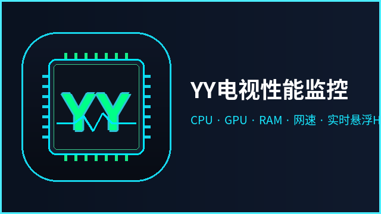
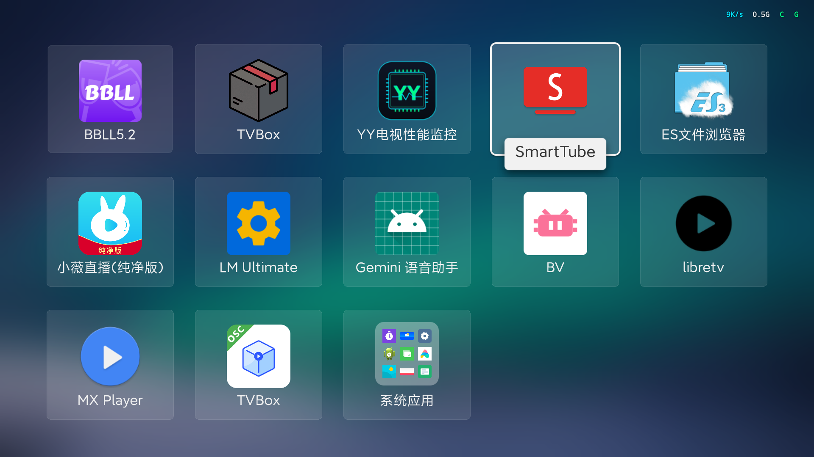
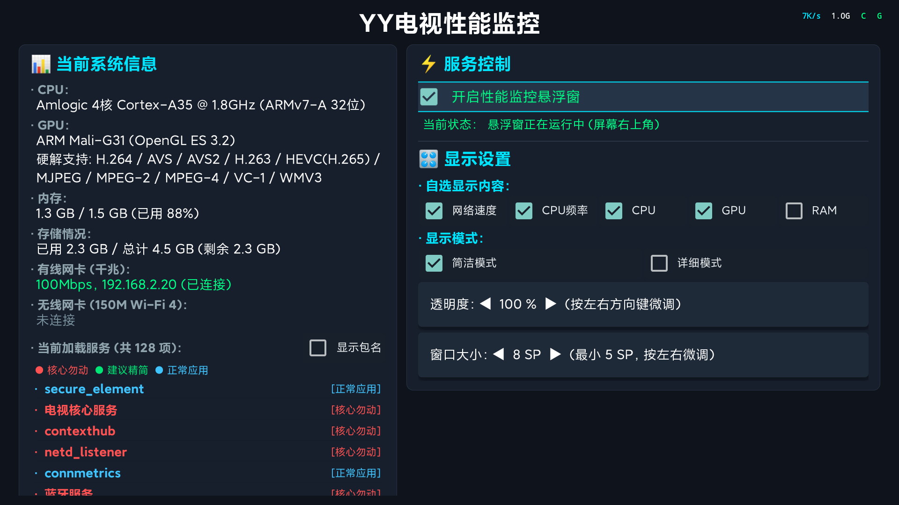

# 🖥️ YY电视性能监控 (YY_TvMonitor)

<p align="center">
  
</p>

<p align="center">
  <strong>专为 Android TV / 智能电视盒子深度定制的原生轻量级性能监视器与系统诊断工具</strong>
</p>

<p align="center">
  
  
  
  
  
  
  
</p>

---

## 📖 项目简介

**YY_TvMonitor** 是一款专为智能电视、投影仪和电视盒子（小米、当贝、华为/荣耀、创维、海信、外贸外销盒子等）设计的**全场景常驻性能监视悬浮窗与系统诊断工具**。

在电视全屏播放高码率 4K 视频（如 **哔哩哔哩 BBLL**、**SmartTube**、**TVBox**、**Kodi**、**爱优腾 TV**）或在电视桌面上，它会在屏幕右上角以**完全无底框、零遮挡纯文字**的形式实时展现整机关键负荷。

### 核心设计哲学
* 🚀 **极致轻量**：采用纯原生 Vanilla Java 编写，**零第三方运行时依赖库**，安装包仅约 **140 KB**，运行内存常驻小于 **2.5 MB**，不跟播放器争抢哪怕 1MB 宝贵运存；
* 🪟 **100% 穿透防拦截**：通过 `FLAG_NOT_TOUCHABLE | FLAG_NOT_FOCUSABLE` 穿透设计，遥控器光标、按键与方向键完全透传底层播放器，绝不拦截任何操作；
* 🔒 **纯本地离线隐私**：**零网络上报、零遥测打点、零第三方 SDK**，不连接任何外部服务器，完全保障用户家庭隐私与数据安全。

---

## 📸 运行效果演示

| 桌面/全屏播放 悬浮窗实时监控 (HUD) | 双栏独立滚动 控制与诊断主界面 |
| :---: | :---: |
|  |  |
| **无边框纯文字 HUD（右上角固定槽位零抖动）** | **左侧独立下拉系统诊断 / 右侧遥控配置面板** |

### 1. 简洁模式（无框纯文字 · 固定物理槽位 · 绝对零抖动）
在屏幕右上角显示极简变色流，每个指标独享固定物理宽度槽位，字符增减时绝不产生位移抖动：

```text
                                       屏幕物理右上角 (距右边距 35px，字形微阴影透光)
                                      ┌──────────────────────────────────────────────┐
                                      │   [ 120K/s ]   [ 1.8G ]   [ C ]   [ G ]   [ R ]│
                                      └──────────────────────────────────────────────┘
```
* 🌐 **实时网络吞吐**：科技青高亮（如 `0B/s`、`120K/s`、`2.5M/s`），内部向右对齐，`/s` 位置绝对恒定；
* ⚡ **CPU 实时主频**：白灰高亮当前内核运行频率（如 `1.0G`、`1.8G`）；
* 🟢 **翡翠绿健康态**（CPU/GPU 负荷 < 75%，RAM < 85%）：单字母显示绿色；
* 🔴 **高亮红警示态**（CPU/GPU 负荷 ≥ 75%，RAM ≥ 85%）：对应字母自动跳红预警。

### 2. 详细模式（完整数据流 · 竖线分隔）
```text
┌────────────────────────────────────────────────────────────────────────┐
│  NET: 2.5 MB/s  |  1.8 GHz  |  CPU: 28%  |  GPU: 32%  |  RAM: 1.2/1.5G  │
└────────────────────────────────────────────────────────────────────────┘
```

---

## ✨ 核心特性

### 1. 🎛️ 双栏式电视遥控控制面板
* **左栏【当前系统信息】（独立下拉滚动）**：
  * **CPU 架构**：硬件芯片型号、核心数、最高主频、标准架构（如 `Amlogic 4核 Cortex-A35 @ 1.8GHz (ARMv7-A 32位)`）；
  * **GPU 与硬解格式**：GPU 型号 (Mali/Adreno 等)、OpenGL ES 版本，并**枚举列出设备硬件支持的全部解码格式**（`H.264 / HEVC(H.265) / AVS / AVS2 / VP9 / VC-1 / MPEG-2` 等）；
  * **运存与存储**：当前已用运存 / 总运存（及百分比），内部存储已用量与剩余空间；
  * **网卡规格探测**：
    * `• 有线网卡 (千兆/百兆)：` 精确识别硬件支持规格、接口形式（板载 DWMAC / USB 扩展）与协商 IP；
    * `• 无线网卡 (Wi-Fi 4/5/6)：` 准确识别 Wi-Fi 芯片型号（如 Realtek RTL8723/8822、Broadcom、联发科等）与接口连接状态；
* **右栏【服务与显示控制】（固定操作台）**：
  * **服务总开关**：秒级开启/关闭悬浮窗守护服务；
  * **自选显示内容**：单行等宽 5 项复选框（`网络速度`、`CPU频率`、`CPU`、`GPU`、`RAM`），勾选即显，取消即隐；
  * **显示模式切换**：`[√] 简洁模式` 与 `[ ] 详细模式` 互斥勾选；
  * **无级微调控制**：
    * **透明度微调**：`10% ~ 100%`，遥控器左右键无级调节；
    * **字号大小微调**：`5 SP ~ 24 SP`，遥控器左右键微调，适配 32 寸小电视到 100 寸巨幕投影。

### 2. 🛡️ 全平台电视后台服务安全三色分级（电视精简利器）
深度扫描包括 Linux 核心服务（`dumpsys activity services`）、底层 Binder 服务（`ServiceManager.listServices()`）与应用服务（`ActivityManager`），提供智能安全精简分类：
* 🔴 **红色 `[核心勿动]`**：
  * **芯片原厂驱动**：晶晨（Amlogic）、瑞芯微（Rockchip）、全志（Allwinner）、联发科（MTK）、海思（Hisilicon）、高通（Qualcomm）底层驱动；
  * **遥控交互组件**：蓝牙协议栈（蓝牙遥控核心）、红外/HID 遥控、HDMI-CEC 联动；
  * **系统关键守护**：SurfaceFlinger 画面合成、音频管理、温控防烧（thermal）、存储挂载（vold）、网络（netd）、电源（power）；
* 🟢 **绿色 `[建议精简]`**：
  * **广告与遥测打点**：各厂商广告 SDK、数据埋点收集（analytics/telemetry）、系统崩溃抓取（dropbox/bugreport）；
  * **开机自启常驻推送**：友盟推送、极光推送（JPush）、个推、厂商多余推送；
  * **无用系统累赘**：厂商屏保、动态壁纸、打印服务、系统强制 OTA 升级器；
* 🔵 **蓝色 `[正常应用]`**：
  * 自动通过 `ApplicationInfo.FLAG_SYSTEM` 识别用户自行安装的各类第三方播放器、当贝桌面、投屏软件等。
* 勾选 **`[√] 显示包名`**，可在每个服务名称下方清晰缩进显示完整 Package Name（如 `↳ com.android.bluetooth`）。

### 3. 🧩 模块化指标槽位架构（HudSlot Architecture）
浮窗核心采用面向对象的 `HudSlot` 槽位管理架构，彻底解决了 Android TextView 字符变动引起的跳动拉伸问题：
* 每个指标均为独立 `TextView`，在初始化时自动测量基准最大长度（如 `"999.9M/s"`、`"1.8G"`、`"C"`）并固定其物理宽度；
* 无论网络速率在 `0B/s` 还是 `120M/s` 之间跃迁，槽位宽度严格恒定，右侧其他指标的屏幕 X 坐标绝对不动；
* 架构高度解耦，未来添加新传感器维度（如温度、FPS、上传流量）仅需一行注册。

---

## 📦 下载与安装

### 预编译 APK 下载
* **正式稳定版**：[YY_TvMonitor_v0.1.apk](YY_TvMonitor_v0.1.apk)
* **最新通用版**：[YY_TvMonitor.apk](YY_TvMonitor.apk)

### 常用安装方式
1. **U 盘安装**：将 APK 复制到 U 盘，插到电视盒子上，使用电视自带文件管理器点击安装；
2. **ADB 远程局域网安装**：
   ```bash
   adb connect <电视IP>:5555
   adb install -r YY_TvMonitor_v0.1.apk
   ```

---

## 🛠️ 自行编译与构建指南

本项目支持使用标准 Android SDK 原生工具链构建，不依赖 Gradle 构建后台，可在极速数十毫秒内完成纯净编译。

### 1. 环境准备
* JDK 1.8+
* Android SDK (API 28 或 30+，需 `javac`, `d8`, `aapt`, `zipalign`, `apksigner`)

### 2. 环境变量与隐私保护配置
仓库中提供 `.env.example` 配置文件模板。首次使用时复制为 `.env`（`.env` 已在 `.gitignore` 中，绝不会被提交到远程仓库）：

```bash
cp .env.example .env
```

编辑 `.env` 设置您的环境参数（可选）：
```bash
# 编译主机（配置在 ~/.ssh/config 中的远程主机或跳板机）
BUILD_HOST=build_server

# 目标电视调试地址
TV_DEVICE=192.168.1.100:5555
```

### 3. 一键编译与推送
```bash
# 仅编译生成 APK (产物输出至当前目录: YY_TvMonitor_v0.1.apk)
bash build.sh

# 编译并一键推送安装至电视启动测试
bash build.sh -i
```

---

## 🎮 ADB 命令行快捷调试

如需在没有遥控器的开发环境下调试，可通过 ADB 发送标准 Intent 控制：

```bash
# 开启悬浮窗 HUD
adb shell am start-foreground-service -a com.tv.cpu.ACTION_START com.tv.cpu/.HudService

# 关闭悬浮窗 HUD (立即从屏幕消除)
adb shell am start-foreground-service -a com.tv.cpu.ACTION_STOP com.tv.cpu/.HudService

# 临时避让隐藏浮窗 1.2 秒（例如弹出输入法时）
adb shell am start-foreground-service -a com.tv.cpu.ACTION_PAUSE_TEMP com.tv.cpu/.HudService

# 查看后台实时监控采样日志
adb shell "logcat -d | grep 'TV_CPU' | tail -n 10"
```

---

## 📊 技术参数一览

| 参数类别 | 技术实现 / 实测指标 | 技术说明 / 用户收益 |
| :--- | :--- | :--- |
| **安装包体积** | **~140 KB** (含全套多密度图标与 TV Banner) | 纯原生 Java 实现，零冗余第三方库，极省存储空间 |
| **运行内存** | **＜ 2.5 MB** | 针对 1GB / 1.5GB 运存的低配盒子深度优化，毫秒级轻快 |
| **悬浮窗穿透性** | `FLAG_NOT_TOUCHABLE \| FLAG_NOT_FOCUSABLE` | **100% 物理穿透**，遥控器光标与全屏播放按键完全不受干扰 |
| **屏幕贴合** | `Gravity.TOP \| Gravity.RIGHT` (X: 35px, Y: 25px) | 贴紧右上角，微阴影渲染，完美适配各类明暗视频场景 |
| **CPU 计算源** | Linux 内核 `/sys/.../cpuidle/state*/time` | 彻底攻破 Android 9+ SELinux 权限封锁，微秒级精准差分 |
| **后台保活机制** | 独立服务进程 `:service` + 电池白名单加固 | 免疫电视系统杀后台，开机自启（需权限允许），秒级唤醒 |

---

## 🗺️ 版本演进路线 (Roadmap)

- [x] **v0.1**：
  - [x] 双模式悬浮窗（极简固定槽位文字 HUD / 详细数据 HUD）；
  - [x] 实时 CPU 负荷、CPU 主频、GPU 仿真负荷、RAM 运存、网络速度监控；
  - [x] 硬件解码器全面探测、网卡物理规格与网络 IP 连接识别；
  - [x] 独立滚动式后台活跃服务全景监控与三色安全精简分类；
  - [x] 连续透明度与连续字号无级调节，遥控器焦点平滑记忆。
- [ ] **v0.2 规划**：
  - [ ] CPU 多核心独立负荷（四核独立小仪表盘）；
  - [ ] SoC 实时温度监控探测（`/sys/class/thermal`）；
  - [ ] 浮窗四角位置自由移动（右上 / 左上 / 右下 / 左下）。

---

## 📜 开源协议

本项目采用 **MIT License** 开源协议，欢迎各位电视盒子玩家与开发者二次定制与交流。

> **免责声明**：本工具提供的【建议精简】标签仅供系统优化诊断参考，请在停用或卸载任何系统服务前明确其用途，避免误删导致特定功能受限。
